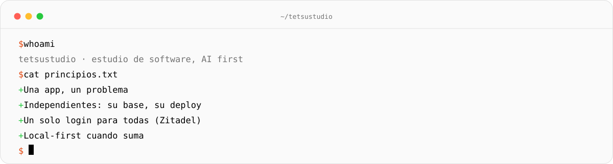

<a href="https://tetsustudio.com">
  <picture>
    <source media="(prefers-color-scheme: dark)" srcset="https://raw.githubusercontent.com/tetsustudio/.github/main/profile/assets/header-dark.svg">
    
  </picture>
</a>

 

<picture>
  <source media="(prefers-color-scheme: dark)" srcset="https://raw.githubusercontent.com/tetsustudio/.github/main/profile/assets/terminal-dark.svg">
  
</picture>

### `> apps`

Cada app resuelve una sola cosa, con su base de datos y su despliegue.

| | App | Qué hace |
|:-:|---|---|
| 🟢 | [**Forge**](https://forge.tetsustudio.com/) | notas Markdown offline, compartidas y con chat |
| 🟢 | [**Glimpse**](https://glimpse.tetsustudio.com/) | lector EPUB y PDF con lectura en voz alta |
| 🟢 | [**Slide**](https://slide.tetsustudio.com/) | textos largos en diapositivas verticales |
| 🟢 | [**hambre**](https://hambre.tetsustudio.com/) | costos de gastronomía, de la receta al plato |
| 🟢 | [**events**](https://events.tetsustudio.com/) | producción de barras para eventos |
| 🟢 | [**Tirame una**](https://tirameuna.tetsustudio.com/) | cartas de preguntas para charlar de a dos |
| 🟢 | **tetsuCode** | agentes de código en terminales visibles, desde el navegador |
| 🟡 | [**Tetsu Chat**](https://chat.tetsustudio.com/) | chat para personas y agentes, sobre Matrix |
| 🟡 | [**Sakura**](https://sakura.tetsustudio.com/app/) | finanzas del mes, sin cuenta y en tu navegador |
| 🟡 | [**Sala**](https://sala.tetsustudio.com/) | el ensayo de la banda, instrumento por instrumento |
| 🟡 | [**Vermut**](https://vermut.tetsustudio.com/) | elegir película en grupo, swipeando |
| 🟡 | [**Babol**](https://babol.tetsustudio.com/) | grupos de hasta 15 personas, sin likes |
| 🟡 | [**loFi**](https://lofi.tetsustudio.com/) | radio lo-fi generada con Stable Audio |
| 🟡 | **microLearn** | estudio con repetición espaciada y ejercicios en el navegador |

🟢 activo · 🟡 beta · todas en [tetsustudio.com](https://tetsustudio.com)

### `> stack`

  
  
  
  
  
  
  
  
  
  
  
  
  
  

鉄 · <a href="https://tetsustudio.com">tetsustudio.com</a>
